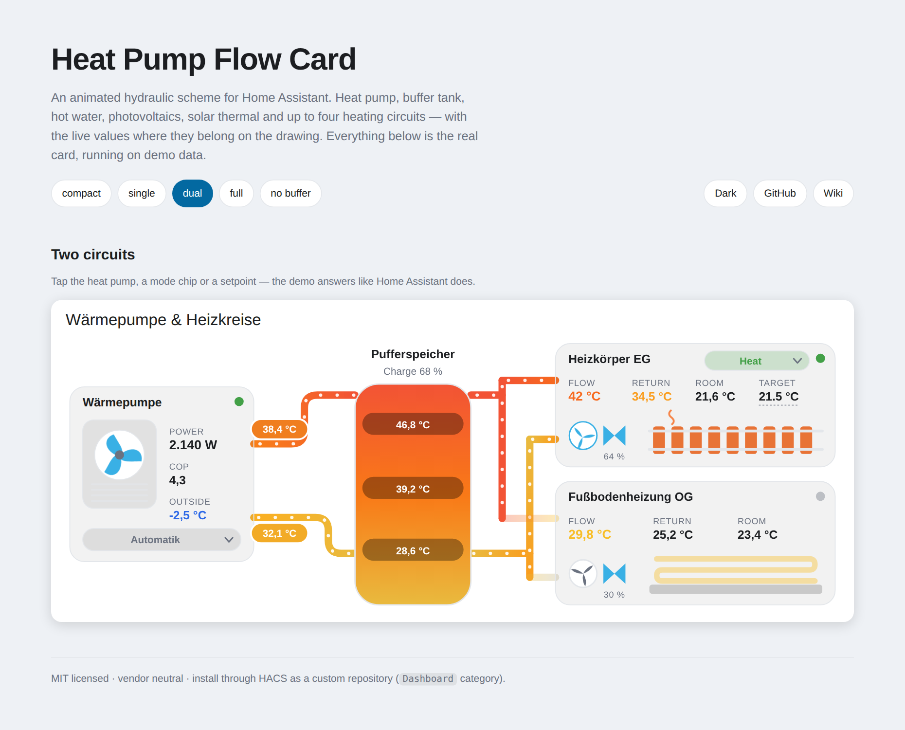

# Development

The card is a single file of plain JavaScript, `dist/heatpump-flow-card.js`.
There is no build step and no dependency at runtime — what is in the repository
is what Home Assistant loads.

```bash
git clone https://github.com/Xerolux/heatpump-flow-card
cd heatpump-flow-card
npm install          # playwright, for the tests and screenshots
```

## Preview in a plain browser

```bash
npm run site         # assembles _site/
xdg-open _site/index.html
```



The same page is published to
[GitHub Pages](https://xerolux.github.io/heatpump-flow-card/) on every push to
`main`.

`tools/preview.html` is the smaller variant used by the tests. Both load
`tools/demo-hass.js`, a Home Assistant stand-in with a full set of demo
entities, and `tools/preview-config.js`, which holds one configuration per
layout.

Query parameters of `preview.html`:

| Parameter | Values |
| --- | --- |
| `layout` | `compact`, `single`, `dual`, `full`, `advanced`, `circuits` |
| `theme` | `light` (default) or `dark` |
| `lang` | `de` (default) or `en` |

## Tests

```bash
npm run check        # syntax
npm run check:docs   # versions, screenshots, examples, wiki links
npm test             # renders the card in Chromium and checks behaviour
```

The tests drive the real card in a real browser: every layout renders without
console errors, taps toggle, press, open option lists and steppers, idle
circuits stay idle, pipes get their colours, and the editor round-trips a
configuration without losing YAML-only options.

## Screenshots

```bash
npm run screenshots  # regenerates docs/images/*.png
npm run brand        # regenerates docs/brand/*.png from icon.svg
```

`docs/brand/icon.svg` is the single source for the icon: the ring is the card's
temperature ramp, the dots are its flow animation and the fan is the heat pump.
Everything else — the app icons, the favicon, both wordmarks and the social
preview — is rendered from it.

Every image in the README and the wiki comes from this script, so they never
drift away from the actual rendering.

## Layout of the source

| Section | What lives there |
| --- | --- |
| Helpers | state access, number formatting, temperature colours |
| Actions | tap and hold, the control model per entity domain |
| Building blocks | panels, readouts, badges, chips, pipes |
| Components | heat pump, tank, hot water, PV, solar, circuits |
| Configuration | normalisation, layout presets, field aliases |
| Scene | geometry, pipe routing |
| Card | the custom element, the popover |
| Editor | `ha-form` schema and the config round-trip |

Drawing happens once; afterwards only the registered update functions run on
every state change, so animations never restart.

## The wiki

`docs/wiki/*.md` is the source; the documentation workflow copies it into the
GitHub wiki on every push to `main` that touches those files.

GitHub only creates the wiki repository once a first page has been saved by
hand, so on a fresh repository: open the **Wiki** tab, create any page, save
it, and re-run **Actions → Documentation → Run workflow**. From then on the
sync overwrites everything and nobody edits the wiki directly - changes made
there are lost on the next push.

## Release Notes Style

The changelog section of a version becomes the release notes verbatim — the
release workflow extracts it, and those notes are what users read in the HACS
update dialog. Write them for that reader, not as an internal audit log:

- Open with one or two sentences of narrative that say *why the release
  matters*, not just what it contains.
- Follow the narrative with `### ⚠️ Upgrade notes`, and keep that block to at
  most five bullets: one-time resets (a model that relearns), counters that
  start fresh with the new version, new options or entities worth enabling,
  and whether rolling back to the previous version is safe. When nothing
  else applies, the rollback bullet alone is a valid block. The upgrade block
  is the first section heading of every release's notes.
- Group the remaining entries under these emoji headers and no others:
  `### ✨ New`, `### 🐛 Bugfixes`, `### 💼 Maintenance`, `### ❤️ Thanks`.
- Lead every bullet with a short bold phrase, then explain in one or two
  sentences — about 60 words at most. Link the issue (`#42`) instead of
  restating the report.
- Credit reporters and contributors by @mention under `### ❤️ Thanks`
  whenever a release was shaped by field data.
- Keep the technical depth, but keep it readable — a user should understand
  the first screen without scrolling.
- `test/changelog-style.test.mjs` fails the build when a section newer than
  1.16.0 opens without the upgrade block, uses a header outside the set
  above, or carries a bullet beyond 60 words. Sections already released keep
  the shape they were published with.
- Section headings inside a version stay `###` so the `## [version]` heading
  keeps its hierarchy; never rename the `## [version] - date` headings, the
  release workflow matches them exactly.

## Releasing

1. Bump `CARD_VERSION` in `dist/heatpump-flow-card.js` and `version` in
   `package.json`, and add a CHANGELOG section for that version.
2. Merge to `main`.
3. Either push a tag — `git tag -a vX.Y.Z -m "vX.Y.Z" && git push origin vX.Y.Z` —
   or start **Actions → Release → Run workflow**, which creates the tag for you
   from the version in the card.

Either way the workflow refuses to publish unless `CARD_VERSION`,
`package.json`, the tag and the CHANGELOG all agree, and then publishes the
release with `heatpump-flow-card.js` attached.
